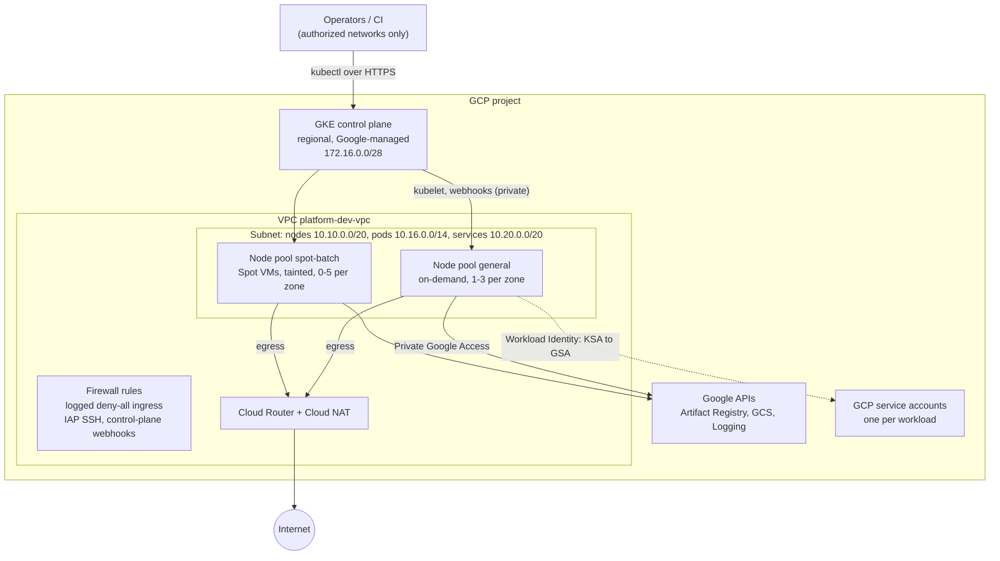

# terraform-gcp-gke-platform

Terraform modules for a private, regional GKE Standard cluster on Google Cloud:
the network it runs in, the cluster and its node pools, and Workload Identity
bindings for the workloads on it. [`examples/dev-platform`](examples/dev-platform)
wires the three modules together.

The defaults describe a non-production environment set up the way production
usually is: private nodes, no service account keys, a least-privilege node
identity, controlled upgrades. The reasoning behind each choice is under
[Design decisions & trade-offs](#design-decisions--trade-offs), and what it costs is under
[Cost notes](#cost-notes).

CI runs `terraform fmt`, `terraform validate` (on the oldest supported and a
current Terraform release) and `tflint` against every module. CI does not
apply anything, so try it in a sandbox project before you build on it.

## What it builds

- **Network**: a custom-mode VPC with one regional subnet. The primary range
  holds nodes and two secondary ranges hold pods and Services. Private Google
  Access is on and VPC Flow Logs are sampled.
- **Egress**: Cloud Router and Cloud NAT, since nodes have no external IPs.
  Dynamic port allocation is on, errors are logged, and static egress IPs are
  optional.
- **Firewall**: a logged baseline deny for all ingress, optional SSH that only
  comes through IAP, and a rule that lets the control plane reach admission
  webhooks running on nodes.
- **Cluster**: a regional GKE Standard cluster with private nodes, authorized
  networks on the control plane, Workload Identity, Dataplane V2, shielded
  nodes, a release channel with a maintenance window, NodeLocal DNSCache, GKE
  cost allocation, and optional Cloud KMS encryption for Secrets.
- **Node pools**: defined as a map. The example has an on-demand `general` pool
  and a tainted Spot `spot-batch` pool that scales to zero.
- **Node identity**: a dedicated service account with
  `roles/container.defaultNodeServiceAccount` and Artifact Registry read access.
  The Compute Engine default service account is not used.
- **Workload identities**: one GCP service account per workload, which a
  specific Kubernetes service account is allowed to impersonate.

## Architecture



Nodes and pods only have internal addresses. Traffic to Google APIs stays on
Google's network through Private Google Access; everything else leaves through
Cloud NAT. The control plane is Google-managed and reaches the nodes over a
private peering connection.

## Repository layout

```text
.
├── modules/
│   ├── network/              VPC, subnet + secondary ranges, Cloud Router/NAT, firewall
│   ├── gke/                  cluster, node pools, node service account, webhook firewall rule
│   └── workload-identity/    GCP service account, KSA binding, project roles
├── examples/
│   └── dev-platform/         all three modules wired together + terraform.tfvars.example
├── .github/workflows/ci.yml  fmt, validate (matrix), tflint
└── .tflint.hcl
```

## Modules

| Module | Creates | Main inputs | Main outputs |
|---|---|---|---|
| [`network`](modules/network) | VPC, subnet with `pods`/`services` secondary ranges, Cloud Router, Cloud NAT (+ optional static IPs), baseline firewall rules | `project_id`, `name`, `region`, `subnet_cidr`, `pods_cidr`, `services_cidr`, `nat_ip_count`, `flow_logs`, `enable_iap_ssh`, `iap_ssh_target_tags`, `labels` | `network_self_link`, `subnet_self_link`, `pods_range_name`, `services_range_name`, `nat_ip_addresses` |
| [`gke`](modules/gke) | Private regional cluster, node pools from a map, node service account + roles, control-plane webhook firewall rule | `project_id`, `name`, `location`, `network`, `subnetwork`, range names, `master_ipv4_cidr_block`, `master_authorized_networks`, `release_channel`, `maintenance_window`, `node_pools`, `logging_components`, `deletion_protection`, `labels` | `name`, `location`, `endpoint`\*, `ca_certificate`\*, `workload_identity_pool`, `node_service_account_email`, `node_pools` |
| [`workload-identity`](modules/workload-identity) | GCP service account, `roles/iam.workloadIdentityUser` for one Kubernetes service account, optional project roles | `project_id`, `account_id`, `namespace`, `kubernetes_service_account`, `project_roles`, `workload_identity_pool` | `email`, `member`, `kubernetes_member`, `kubernetes_annotation` |

\* sensitive. Every variable has a type and a description, and most have
validation, so `variables.tf` and `outputs.tf` in each module are the full
reference.

Node pools are a map keyed by pool name. Every attribute is optional:

```hcl
node_pools = {
  general = {
    machine_type = "e2-standard-4" # default
    min_count    = 1               # per zone (default 1)
    max_count    = 3               # per zone (default 3)
  }
  spot-batch = {
    machine_type = "n2d-standard-4"
    spot         = true # default false
    min_count    = 0
    max_count    = 5
    labels       = { workload-type = "batch" }
    taints       = [{ key = "cloud.google.com/gke-spot", value = "true", effect = "NO_SCHEDULE" }]
    # also: image_type, disk_type, disk_size_gb, max_surge, max_unavailable, network_tags
  }
}
```

## Usage

### Prerequisites

- Terraform >= 1.5 and the `gcloud` CLI.
- A GCP project with billing enabled. The identity running Terraform needs to
  create networks, firewall rules, clusters, service accounts and project IAM
  bindings: Owner on a sandbox project, or Compute Network Admin, Compute
  Security Admin, Kubernetes Engine Admin, Service Account Admin, Project IAM
  Admin and Service Usage Admin.
- Application Default Credentials: `gcloud auth application-default login`.

### Run the example

```bash
cd examples/dev-platform
cp terraform.tfvars.example terraform.tfvars
# set project_id, and put your own egress IP/CIDR in master_authorized_networks

terraform init
terraform plan -out=tfplan
terraform apply tfplan

# kubeconfig for the new cluster
eval "$(terraform output -raw get_credentials_command)"
kubectl get nodes -L cloud.google.com/gke-nodepool
```

The example enables the APIs it needs (`enable_project_apis = true`). Creating
a regional cluster and its node pools usually takes 10 to 20 minutes.

### Use the modules from another repository

```hcl
module "gke" {
  source = "git::https://github.com/gopisaluja/terraform-gcp-gke-platform.git//modules/gke?ref=v0.1.0"
  # ...
}
```

Pin `ref` to a tag. Each module declares its own `required_providers`, and the
caller configures the `google` provider.

### Connect a workload to its GCP service account

For each entry in `workload_identities`, the example outputs the GCP service
account email and the annotation the Kubernetes service account needs:

```yaml
apiVersion: v1
kind: ServiceAccount
metadata:
  name: orders-api
  namespace: orders
  annotations:
    iam.gke.io/gcp-service-account: platform-dev-orders-api@<project>.iam.gserviceaccount.com
```

Pods that use this service account get short-lived credentials for the GCP
service account from the GKE metadata server. No key file is involved.

### Schedule onto the Spot pool

The Spot pool is tainted, so a pod has to opt in:

```yaml
spec:
  nodeSelector:
    cloud.google.com/gke-spot: "true" # label GKE adds to Spot nodes
  tolerations:
    - key: cloud.google.com/gke-spot
      operator: Equal
      value: "true"
      effect: NoSchedule
```

### Tear down

`deletion_protection` defaults to `true`. Set it to `false`, run
`terraform apply`, and then run `terraform destroy`.

## Naming and labels

- **Names** follow `<name>-<environment>-<thing>`: `platform-dev-vpc`,
  `platform-dev-gke`, `platform-dev-gke-nodes@…`, `platform-dev-allow-iap-ssh`.
  Variable validation keeps the derived names inside GCP's length limits (30
  characters for service account IDs), so a name that is too long fails at
  `plan` time, not halfway through an `apply`.
- **Labels** come from one map in `examples/dev-platform/main.tf`:

  ```hcl
  labels = {
    env         = var.environment
    team        = var.team
    cost-center = var.cost_center
    managed-by  = "terraform"
  }
  ```

  Each module takes a `labels` input and always adds `managed-by = "terraform"`.
  The cluster gets them as `resource_labels`. Every node pool gets them as GCE
  resource labels on its VMs and disks, plus `node-pool = <name>`, and those are
  the labels that appear in the billing export. Static NAT IPs are labelled too.
  The GCP API does not support labels on VPCs, subnets, routers, firewall rules
  or service accounts, so for those resources the naming convention carries the
  same information.

## Design decisions & trade-offs

### Regional rather than zonal

A regional cluster runs control plane replicas in three zones. The API server
stays up through control plane upgrades and a single-zone outage, and the
control plane SLA is 99.95% (99.5% for zonal). Nodes are spread across the same
zones, so losing a zone costs a third of capacity, not all of it.

The costs:

- Every per-zone node count is multiplied by the number of zones. `min_count = 1`
  means at least three nodes.
- The GKE free-tier credit does not cover regional clusters.
- Traffic between zones is billed.

For a short-lived sandbox, pass a zone as `location` (for example
`us-central1-a`) and the same module builds a zonal cluster.

### Private nodes, and what Cloud NAT costs

Nodes only have internal IPs. Nothing on the internet can open a connection to
a node, and the setup is compatible with the
`constraints/compute.vmExternalIpAccess` organization policy. Outbound traffic
goes through Cloud NAT, which is billed per gateway-hour and per GiB processed.
Private Google Access keeps Artifact Registry, GCS and Cloud Logging traffic
off NAT. The traffic that does go through NAT is mostly image pulls from public
registries and calls to third-party APIs.

The usual way NAT fails is source port exhaustion when many pods on one node
call the same destination. Dynamic port allocation (64 to 4,096 ports per VM)
absorbs bursts, and NAT logging is set to `ERRORS_ONLY`, so any
`OUT_OF_RESOURCES` drops appear in Cloud Logging. Set `nat_ip_count` when a
partner needs a fixed egress IP to allowlist.

The control plane keeps its public endpoint, restricted to
`master_authorized_networks` (empty by default, which means no external
access). A fully private endpoint (`enable_private_endpoint = true`) is more
locked down, but kubectl and CI then need a route into the VPC: VPN,
Interconnect, a bastion, or Connect gateway. Turn it on once that route exists.

### Spot node pools for batch, behind a taint

Interruptible work such as batch jobs, CI runners and queue consumers can run on
Spot VMs at a large discount. The Spot pool:

- is tainted `cloud.google.com/gke-spot=true:NoSchedule`, so nothing lands
  there unless it tolerates the taint;
- uses `location_policy = "ANY"`, so the autoscaler can add nodes in whichever
  zone currently has Spot capacity;
- has `min_count = 0`, so it costs nothing while there is no work.

Compute Engine can reclaim Spot VMs at any time with about 30 seconds' notice,
and Spot capacity is not guaranteed. Stateful workloads, and anything protected
by a strict PodDisruptionBudget, belong on the on-demand pool. If a Spot pool
is defined without taints, the `gke` module raises a `check` warning during
plan.

### Workload Identity instead of JSON keys

Service account keys are long-lived bearer credentials. They get copied into
Secrets, CI variables and occasionally container images, and rotating them is
manual work that tends not to happen. With Workload Identity, a Kubernetes
service account is allowed to impersonate a GCP service account, and pods get
short-lived tokens from the GKE metadata server. There is nothing to store or
rotate, and the `iam.disableServiceAccountKeyCreation` organization policy can
be enforced.

Node pools run with `workload_metadata_config.mode = "GKE_METADATA"`, so pods
never see the node's own credentials either.

The module uses the GCP-service-account impersonation pattern, not direct
Workload Identity Federation (granting roles straight to a `principal://`
Kubernetes identity). Impersonation works with every Google API and client
library and with the `iam.gke.io/gcp-service-account` annotation most Helm
charts already expose. It also keeps "which identity can do what" as a list of
service accounts that is easy to audit. The cost is one extra IAM object per
workload. The binding also requires the identity pool to exist, so the example
feeds the cluster's `workload_identity_pool` output into the module, which
orders it after cluster creation.

### Dataplane V2

`datapath_provider = "ADVANCED_DATAPATH"` uses GKE's eBPF dataplane, which is
built on Cilium. Kubernetes NetworkPolicy is enforced without the Calico
add-on, kube-proxy's iptables rules are replaced, and network policy logging is
available. The trade-offs:

- It can only be set when the cluster is created. Switching later means
  replacing the cluster.
- Calico-specific resources such as `GlobalNetworkPolicy` do not apply. Plain
  NetworkPolicy does, and so does GKE's Cilium cluster-wide policy, which is
  available but not enabled here.

### Release channel and maintenance timing

The default channel is `REGULAR`. New versions reach `RAPID` first, then
`REGULAR`, then `STABLE`. A common split is non-production on `REGULAR` and
production on `STABLE`, so every new minor version runs in dev for a while
before it reaches prod. `EXTENDED` keeps a minor version supported for longer,
for an extra fee.

A channel does not let you stay on one version indefinitely, but you do control
when upgrades happen:

- `maintenance_window` defaults to 01:00–09:00 UTC on Saturdays and Sundays.
  GKE requires at least 48 hours of availability per 32 days, and this gives
  about 64.
- `maintenance_exclusions` blocks upgrades during a freeze (for example
  `NO_MINOR_UPGRADES` over a release period).

Node pools surge one node per zone at a time (`max_surge = 1`,
`max_unavailable = 0`), so capacity never drops during an upgrade. Workloads
are only protected during upgrades if they have PodDisruptionBudgets.

### Smaller choices

- **Node service account**: a dedicated account with
  `roles/container.defaultNodeServiceAccount`. The Compute Engine default
  account often has Editor on the project. GKE always creates a default node
  pool when it creates a cluster; the module builds that pool with the dedicated
  account and deletes it straight away, so the default account is never used.
- **Firewall targeting**: the webhook rule targets the node service account
  rather than a network tag, because anyone who can edit an instance can change
  its tags. The webhook ports default to 8443, 9443 and 15017. Without the rule,
  webhooks served on those ports (ingress-nginx, Gatekeeper, Istio and many
  operators) fail with timeouts on private clusters.
- **Logged deny-all**: the VPC already denies ingress implicitly, but the
  implied rule cannot be logged. An explicit copy at priority 65534 makes denied
  traffic visible and does not change behaviour.
- **Plan-time checks**: a precondition catches overlapping subnet, pod and
  service ranges during `plan`, before anything is created.
- **deletion_protection** defaults to `true`.

## Cost notes

Prices change, so check the current GCP pricing pages. As a guide to where the
money goes:

- **Cluster fee**: GKE charges a flat management fee per cluster-hour (USD
  0.10/hour at the time of writing). The monthly free-tier credit applies only
  to zonal and Autopilot clusters, so this regional cluster pays the full fee.
- **Minimum nodes**: with the example defaults, at least three `e2-standard-4`
  nodes run around the clock (one per zone). This is the largest idle cost. For
  a sandbox, cut `node_locations` to one or two zones, use a smaller machine
  type, or go zonal.
- **Spot**: Spot VMs are typically 60–91% cheaper than on-demand, and the batch
  pool costs nothing while it is scaled to zero.
- **Cloud NAT**: charged per gateway-hour plus per GiB processed. Heavy image
  pulls from Docker Hub or other public registries add up. Mirroring images into
  Artifact Registry in the same region moves that traffic onto Private Google
  Access. Each static NAT IP is billed per hour.
- **Cross-zone traffic**: traffic between nodes in different zones is billed.
  Chatty services spread across three zones can generate a noticeable amount of
  it; topology-aware routing helps.
- **Logging**: Cloud Logging bills per GiB ingested above the free monthly
  allotment, and container logs (`WORKLOADS`) are usually the largest source.
  If logs already go to an in-cluster EFK or Loki stack, set
  `logging_components = ["SYSTEM_COMPONENTS"]` so you are not paying twice. Flow
  logs (25% sampling) and NAT logs (errors only) are tuned for low volume.
- **Managed Prometheus** is off by default because it is billed per sample
  ingested. Turn it on if it replaces a self-managed Prometheus.
- **Visibility**: GKE cost allocation is enabled and free. With a BigQuery
  billing export, it breaks cluster cost down by namespace and Kubernetes label.
  Combined with the `team` and `cost-center` labels, that answers "who is
  spending what".

## CI

`.github/workflows/ci.yml` runs on pushes to `main` and on pull requests:

| Job | What it does |
|---|---|
| `fmt` | `terraform fmt -check -recursive` |
| `validate` | `terraform init -backend=false` + `terraform validate` for each module and the example, on Terraform 1.5.7 (the minimum allowed) and 1.15.x |
| `tflint` | `tflint --recursive` with the `terraform` recommended preset, the Google ruleset, and documented variables/outputs enforced |

CI does not run `plan` or `apply`, because that needs cloud credentials. The
next step would be a plan job authenticated with Workload Identity Federation
from GitHub Actions, which also avoids keys.

## Not included

These are out of scope for now, and each would be its own module or layer:
Shared VPC (host and service projects), multi-region, Autopilot, a GitOps
bootstrap (Argo CD or Config Sync), Backup for GKE, Binary Authorization, the
DNS-based control plane endpoint, and egress lockdown with FQDN-based firewall
policies.

## License

[MIT](LICENSE)
